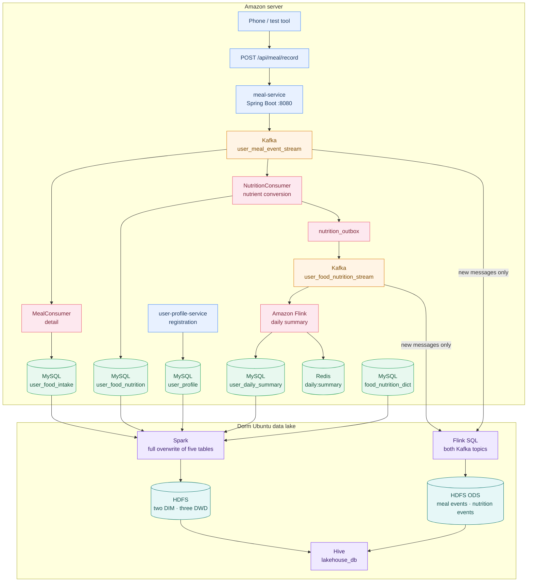

<a id="en"></a>

<div align="center">

# Diet Health Platform

Realtime intake and nutrient calculation, plus a Hadoop lakehouse on the dorm Ubuntu machine

[What it does](#en-what) · [Architecture](#en-arch) · [Layout](#en-layout) · [Modules](#en-modules) · [Tables](#en-tables) · [Health figures](#en-metrics) · [Start](#en-start) · [中文](README.zh-CN.md)

Stack

        

</div>

This repository is the whole project and covers two machines.

The Amazon server runs the realtime path. A user reports what was eaten and how many grams over HTTP. Spring Boot writes that event to Kafka. After the nutrients are calculated, Flink builds a per-person, per-day summary and stores it in MySQL and Redis. The Ubuntu machine in the dorm runs the data lake. It connects out to Amazon and pulls the already calculated data into Hadoop for later Spark analysis. Nutrition is calculated once, on Amazon.

The Ubuntu configuration, pull scripts, and Hive tables are in [`ubuntu/README.md`](ubuntu/README.md). The Amazon server is described first. Its code is a multi-module workspace, not one Maven parent project.

<a id="en-what"></a>

## What the system does

1. Accepts an uploaded intake: food code, food name, grams, and meal.
2. Publishes the record to the Kafka topic `user_meal_event_stream`.
3. **Branch A (detail):** the check-in consumer in `meal-service` writes `user_food_intake`. A second consumer of the same topic looks up the food dictionary and writes `user_food_nutrition`.
4. **Branch B (summary):** the Flink job aggregates by user and calendar day in a 5-second tumbling window and writes both:
   - MySQL table `user_daily_summary` (cumulative UPSERT)
   - Redis hash `daily:summary:{userId}:{statDate}` (TTL 2 days, for realtime reads)

`data/` holds public NHANES 2021–2023 survey files for learning, classroom discussion, and method demonstrations in this project. They are not medical advice. Sources and columns are in [`data/README.md`](data/README.md).

<a id="en-arch"></a>

## Architecture



The dorm machine connects out to Amazon. Purple is the data lake: Flink writes new messages from both Kafka topics into ODS, and Spark copies the profile, food dictionary, intake, nutrition, and daily summary from MySQL onto HDFS. Nutrition is not calculated again on Ubuntu. Details are in [`ubuntu/README.md`](ubuntu/README.md).

<a id="en-layout"></a>

## Layout

```
.
├── meal-service/                 Spring Boot intake and detail service
│   ├── pom.xml
│   └── src/main/java/com/example/meal_service/
│       ├── MealServiceApplication.java
│       ├── MealController.java   POST /api/meal/record
│       ├── MealEvent.java        event DTO
│       ├── MealConsumer.java     Kafka consumer writing user_food_intake
│       ├── NutritionConsumer.java  other group; writes user_food_nutrition after a dictionary lookup
│       ├── NutritionConversionService.java  transactional conversion and outbox event
│       ├── NutritionOutboxPublisher.java  retries publication of nutrition events
│       ├── FoodIntakeEntity.java  table user_food_intake
│       ├── FoodIntakeRepository.java
│       ├── FoodNutritionEntity.java  table food_nutrition_dict
│       ├── FoodNutritionRepository.java
│       ├── MealRecordEntity.java  table user_food_nutrition
│       └── MealRecordRepository.java
├── meal-flink-job/               Flink daily-summary job
│   ├── pom.xml
│   └── src/main/java/com/meal/flink/NutritionDailySummaryJob.java
├── user-profile-service/          Spring Boot profile service
├── data/                          Public NHANES files for learning and discussion; see data/README.md
├── scripts/data-import/           Food-dictionary import and completion scripts
├── docs/                          Topic notes, load-test plan, and the original design
├── start-flink-job.sh            Waits until Flink is ready, then submits the job once
├── ubuntu/                        Hadoop lakehouse on the dorm Ubuntu machine
│   ├── flink/                     Kafka-to-ODS subscription, plus the Hive container
│   ├── hdfs/                      NameNode
│   ├── hive/lakehouse_full.sql    Hive external tables
│   └── scripts/                   Spark full overwrite, and a regression script that has not produced a model
└── README.md                      This document
```

<a id="en-modules"></a>

## Modules

### 1. meal-service

- **Stack:** Spring Boot 4.1.1, Java 17, Spring Web, Spring Kafka, Spring Data JPA, MySQL Connector
- **Port:** `8080`
- **Kafka:** `localhost:9092`
- **MySQL:** `jdbc:mysql://localhost:3306/diet_health` (user `root`; password is supplied outside the committed files)
- **JPA:** `spring.jpa.hibernate.ddl-auto=none`. Create the tables before startup.

#### HTTP API

`POST /api/meal/record`

Example body:

```json
{
  "userId": "user_001",
  "timestamp": 1728691200000,
  "mealType": "Lunch",
  "foodCode": "11100000",
  "foodName": "米饭",
  "portionG": 200.0
}
```

- `userId`, `mealType`, `foodCode`, and `foodName` are required.
- `portionG` must be greater than 0.
- An empty `timestamp` is filled with the current time in milliseconds.
- The server publishes JSON with Jackson. **The partition key is `userId`.**

The raw topic currently carries `userId`, `timestamp`, `mealType`, `foodCode`, `foodName`, and `portionG`. After conversion, the transactional outbox publishes the full nutrition event to `user_food_nutrition_stream`. Flink consumes only that topic.

#### Kafka consumers

`MealConsumer` listens on the raw topic in group `meal_mysql_consumer_group` with concurrency 3. A complete message is written to `user_food_intake`. The millisecond timestamp is stored as `record_time` in UTC. Older messages that lack food fields are skipped and logged.

`NutritionConsumer` uses a different group, `meal_nutrition_consumer_group`, on the same topic. It looks up `food_nutrition_dict` by `food_code` and writes ordinary nutrients and HEI food equivalents to `user_food_nutrition` as `dictionary value × portion_g / unit_weight_g`. Missing food-pattern components stay `NULL`, and `pattern_data_available` is set to 0. The nutrition row and the `nutrition_outbox` event are saved in one MySQL transaction. A background publisher sends the event to `user_food_nutrition_stream` and keeps retrying after a failure.

### 2. meal-flink-job

- **Stack:** Apache Flink 1.17.2, Java 11, Flink Kafka Connector, Flink JDBC Connector, Jedis
- **Main class:** `com.meal.flink.NutritionDailySummaryJob`
- **Job name:** `MealDailySummaryRealtimeAggregationJob`
- **Topic:** `user_food_nutrition_stream`
- **Consumer group:** `flink_nutrition_daily_summary_v1`
- **Start offset:** resume a committed offset when one exists; the first run starts at `earliest`
- **Time:** event time, split into dates in `Asia/Shanghai`, with 5 minutes of allowed lateness
- **State:** full running totals keyed by `userId + statDate`, deduplicated by `nutritionId`
- **Fault tolerance:** a checkpoint every 10 seconds

The longer note is [`docs/FLINK_DAILY_SUMMARY_README.md`](docs/FLINK_DAILY_SUMMARY_README.md).

#### MySQL sink

`user_daily_summary` is written with `INSERT ... ON DUPLICATE KEY UPDATE`, replacing that day's full totals. The table needs a unique key on `(user_id, stat_date)`.

#### Redis sink

The hash key is:

```
daily:summary:{userId}:{yyyy-MM-dd}
```

Fields include `total_calories`, `total_carbohydrate_g`, `total_protein_g`, `total_fat_g`, `total_sodium_mg`, `total_potassium_mg`, and `meal_count`. The TTL is 172800 seconds (2 days). The connector address is hard-coded as `localhost:6379`.

The Flink job currently uses `localhost` for Kafka, MySQL, and Redis. In this environment the JobManager and TaskManager use **host networking**, so `localhost` inside the container reaches Kafka, MySQL, and Redis on the host. A bridge network would require those addresses to change together.

### 3. data/

`data/diet_foods_extracted.csv` has 100,116 rows and 6,751 respondents. One row is one food. Columns are respondent id, age, sex, race or ethnicity, BMI, weight, height, waist, clock time, meal, USDA food code, food name, grams, and that portion's energy, carbohydrate, protein, total fat, total sugar, and sodium. Respondent ids 130378–142310 are the public NHANES release for August 2021 through August 2023. The file is not on the realtime path. It is used to import profiles and the food dictionary, and it is also an offline analysis sample.

`data/nhanes/2021-2023/` holds the original XPT files downloaded from the CDC for the same cycle: physical activity, blood pressure, lipids, glucose, glycated hemoglobin, sleep, smoking, alcohol, and self-reported medical conditions. Official links and the learning-use note are in [`data/README.md`](data/README.md).

<a id="en-tables"></a>

## Tables (diet_health)

Five tables remain: profile, what was eaten, calculated nutrients, the food dictionary, and the Flink daily summary.

### user_profile

Account and body profile. Phone registration is written by `user-profile-service` with `source_type` `real`. The 6,751 survey respondents in the CSV are written by `scripts/data-import/import_user_profiles.py`. For them, `user_id`, `account`, and `nhanes_respondent_id` are the respondent id, and `source_type` is `nhanes`. The survey has no activity, goal, or target calories, so those columns stay empty.

Primary key: `user_id`. `account` is unique.

| Column | Type | Meaning |
|------|------|------|
| `user_id` | varchar(64) | Primary key. Generated for a phone registration; equal to the respondent id for a survey user |
| `account` | varchar(64) | Login name, unique |
| `password_hash` | varchar(255) | PBKDF2-SHA256 password hash |
| `display_name` | varchar(64) | Display name |
| `source_type` | varchar(32) | `real` for a phone user, `nhanes` for a survey respondent |
| `nhanes_respondent_id` | bigint | Respondent id for a survey row; empty for a real user |
| `age` | int | Age in years |
| `gender` | varchar(16) | `Male` or `Female` |
| `height_cm` | decimal(5,2) | Height in centimeters |
| `weight_kg` | decimal(5,2) | Weight in kilograms |
| `waist_cm` | decimal(5,2) | Waist in centimeters |
| `bmi` | decimal(4,2) | Body mass index |
| `activity_level` | varchar(32) | `sedentary`, `light`, or `moderate`. Empty for survey users |
| `pal_coefficient` | decimal(4,3) | Physical activity level. Empty for survey users |
| `goal_type` | varchar(16) | `lose`, `maintain`, or `gain`. Empty for survey users |
| `target_weight_kg` | decimal(5,2) | Target weight in kilograms |
| `target_calories` | decimal(7,2) | Earlier target calories. Current registration and survey import do not write this column |
| `created_at` | timestamp | Created at |
| `updated_at` | timestamp | Updated at |

### user_food_intake

What the user actually uploaded. One row is one food: what was eaten and how many grams. `meal-service` writes it after consuming Kafka. The nutrient result is in `user_food_nutrition`, and `intake_id` points back to this table's `id`.

Primary key: `id`. Indexes: `(user_id, record_time)`, `food_code`.

| Column | Type | Meaning |
|------|------|------|
| `id` | bigint | Autoincrement primary key |
| `user_id` | varchar(64) | User id |
| `record_time` | datetime | Eating time |
| `meal_type` | varchar(32) | Breakfast, lunch, dinner, or snack |
| `food_code` | varchar(64) | Food code, matching `food_nutrition_dict.food_code` |
| `food_name` | varchar(128) | Food name at upload time |
| `portion_g` | decimal(10,2) | Grams eaten |
| `created_at` | timestamp | Upload time |

### user_food_nutrition

Nutrients calculated for one check-in. One row matches one `user_food_intake` row through `intake_id`. The conversion consumer writes ordinary nutrients, fatty acids, and HEI food equivalents. Unknown pattern components stay `NULL` and are not stored as 0.

Primary key: `id`. Indexes: `(user_id, timestamp)`, `intake_id`. Foreign key: `intake_id` → `user_food_intake.id`. Deleting a check-in sets `intake_id` to null.

| Column | Type | Meaning |
|------|------|------|
| `id` | bigint | Autoincrement primary key |
| `user_id` | varchar(64) | User id |
| `intake_id` | bigint | Matching `user_food_intake.id`. Older rows may be empty |
| `timestamp` | bigint | Event time in milliseconds |
| `meal_type` | varchar(32) | Meal |
| `calories` | double | Energy in kilocalories. Default 0 |
| `carbohydrate_g` | double | Carbohydrate in grams. Default 0 |
| `protein_g` | double | Protein in grams. Default 0 |
| `total_fat_g` | double | Total fat in grams. Default 0 |
| `total_sugar_g` | double | Total sugar in grams. Default 0 |
| `dietary_fiber_g` | double | Fiber in grams. Default 0 |
| `sodium` | double | Sodium in milligrams. Default 0 |
| `potassium` | double | Potassium in milligrams. Default 0 |
| `added_sugar_g` | double | Added sugar in grams. Empty when unknown |
| `saturated_fat_g` | double | Saturated fat in grams. Default 0 |
| `monounsaturated_fat_g` | double | Monounsaturated fat in grams |
| `polyunsaturated_fat_g` | double | Polyunsaturated fat in grams |
| `whole_grain_oz_eq` | double | Whole grains, ounce equivalents |
| `refined_grain_oz_eq` | double | Refined grains, ounce equivalents |
| `total_vegetable_cup_eq` | double | Total vegetables, cup equivalents |
| `dark_green_veg_beans_cup_eq` | double | Dark-green vegetables and beans, cup equivalents |
| `total_fruit_cup_eq` | double | Total fruit, cup equivalents |
| `whole_fruit_cup_eq` | double | Whole fruit, cup equivalents |
| `dairy_cup_eq` | double | Dairy, cup equivalents |
| `seafood_plant_protein_oz_eq` | double | Seafood or plant protein, ounce equivalents |
| `pattern_data_available` | tinyint(1) | Whether the HEI food pattern is known |
| `unsaturated_saturated_fat_ratio` | double | Unsaturated-to-saturated fat ratio. Default 0 |

### food_nutrition_dict

Nutrients per food code, stored per 100 grams, for lookup and conversion. Energy, carbohydrate, protein, total fat, and sodium come from `data/diet_foods_extracted.csv`. `scripts/data-import/import_food_nutrition_dict.py` writes them as `nutrient total ÷ gram total × 100` for 3,986 USDA foods. Potassium, total sugar, fiber, saturated fat, monounsaturated fat, polyunsaturated fat, cholesterol, vitamins A, C, D, E, and K, thiamin, riboflavin, niacin, vitamin B6, folate, vitamin B12, calcium, iron, magnesium, zinc, selenium, caffeine, and alcohol come from FNDDS 2021–2023 (`data/FNDDS_2021-2023_Nutrient_Values.xlsx`) through `scripts/data-import/supplement_food_dict_from_fndds.py`, matched by food code. Added sugar and HEI food-pattern equivalents are written by `scripts/data-import/supplement_food_patterns.py`. The first choice is a direct match to FPED for 2017 through March 2020 (`data/FPED_1720.xls`), which is already per 100 grams. Foods that do not match are rolled up from the FNDDS 2021–2023 recipe (`data/FNDDS_2021-2023_Ingredients.xlsx`) and FPID 2017–2018 ingredient equivalents (`data/FPID_1718.xls`), then scaled back to 100 grams of the finished food. FPED 2021–2023 has not been published, so this is not that official file. Of 3,989 dictionary rows, 3,957 match directly, 16 are recipe rollups, and 16 cannot be completed, including `F1001`, `F1002`, and `F1003`. Missing components stay empty. They are not replaced with 0.

Primary key: `id`. Unique key: `food_code`. Index: `food_name`.

| Column | Type | Meaning |
|------|------|------|
| `id` | bigint | Autoincrement primary key |
| `food_code` | varchar(64) | Food code, unique |
| `food_name` | varchar(128) | Food name |
| `unit_weight_g` | decimal(6,2) | Weight the nutrient values refer to, default 100 grams |
| `energy_kcal` | decimal(6,2) | Energy for that weight. Default 0 |
| `carbohydrate_g` | decimal(6,2) | Carbohydrate, grams |
| `protein_g` | decimal(6,2) | Protein, grams |
| `total_fat_g` | decimal(6,2) | Fat, grams |
| `total_sugar_g` | decimal(6,2) | Total sugar, grams. From FNDDS, per 100 grams |
| `dietary_fiber_g` | decimal(6,2) | Fiber, grams. From FNDDS, per 100 grams |
| `saturated_fat_g` | decimal(6,2) | Saturated fat, grams. From FNDDS, per 100 grams |
| `monounsaturated_fat_g` | decimal(6,2) | Monounsaturated fat, grams. From FNDDS, per 100 grams |
| `polyunsaturated_fat_g` | decimal(6,2) | Polyunsaturated fat, grams. From FNDDS, per 100 grams |
| `sodium_mg` | decimal(7,2) | Sodium, milligrams |
| `potassium_mg` | decimal(7,2) | Potassium, milligrams. USDA foods come from FNDDS |
| `cholesterol_mg` | decimal(7,2) | Cholesterol, milligrams. Per 100 grams |
| `vitamin_a_rae_mcg` | decimal(7,2) | Vitamin A, micrograms RAE. Per 100 grams |
| `vitamin_c_mg` | decimal(7,2) | Vitamin C, milligrams. Per 100 grams |
| `vitamin_d_mcg` | decimal(7,2) | Vitamin D, micrograms. Per 100 grams |
| `vitamin_e_mg` | decimal(7,2) | Vitamin E, milligrams. Per 100 grams |
| `vitamin_k_mcg` | decimal(7,2) | Vitamin K, micrograms. Per 100 grams |
| `thiamin_mg` | decimal(7,2) | Thiamin, vitamin B1, milligrams. Per 100 grams |
| `riboflavin_mg` | decimal(7,2) | Riboflavin, vitamin B2, milligrams. Per 100 grams |
| `niacin_mg` | decimal(7,2) | Niacin, vitamin B3, milligrams. Per 100 grams |
| `vitamin_b6_mg` | decimal(7,2) | Vitamin B6, milligrams. Per 100 grams |
| `folate_mcg` | decimal(7,2) | Total folate, micrograms. Per 100 grams |
| `vitamin_b12_mcg` | decimal(7,2) | Vitamin B12, micrograms. Per 100 grams |
| `calcium_mg` | decimal(7,2) | Calcium, milligrams. Per 100 grams |
| `iron_mg` | decimal(7,2) | Iron, milligrams. Per 100 grams |
| `magnesium_mg` | decimal(7,2) | Magnesium, milligrams. Per 100 grams |
| `zinc_mg` | decimal(7,2) | Zinc, milligrams. Per 100 grams |
| `selenium_mcg` | decimal(7,2) | Selenium, micrograms. Per 100 grams |
| `caffeine_mg` | decimal(7,2) | Caffeine, milligrams. Per 100 grams |
| `alcohol_g` | decimal(7,2) | Alcohol, grams. Per 100 grams |
| `added_sugar_g` | decimal(8,2) | Added sugar, grams. Per 100 grams. Teaspoon equivalents × 4.2. Empty means unknown |
| `whole_grain_oz_eq` | decimal(10,4) | Whole grains, ounce equivalents. Per 100 grams |
| `refined_grain_oz_eq` | decimal(10,4) | Refined grains, ounce equivalents. Per 100 grams |
| `total_vegetable_cup_eq` | decimal(10,4) | Total vegetables, cup equivalents. Per 100 grams. Includes beans |
| `dark_green_veg_beans_cup_eq` | decimal(10,4) | Dark-green vegetables and beans, cup equivalents. Per 100 grams |
| `total_fruit_cup_eq` | decimal(10,4) | Total fruit, cup equivalents. Per 100 grams |
| `whole_fruit_cup_eq` | decimal(10,4) | Whole fruit, cup equivalents. Per 100 grams. Total fruit minus juice |
| `dairy_cup_eq` | decimal(10,4) | Dairy, cup equivalents. Per 100 grams |
| `seafood_plant_protein_oz_eq` | decimal(10,4) | Seafood and plant protein, ounce equivalents. Per 100 grams. Includes fish, soy, nuts, and beans |
| `fped_source` | varchar(32) | Source. `fped_1720` is a direct match, `ingredient_rollup` is a recipe rollup, `missing` could not be completed |

### user_daily_summary

Flink's per-user, per-day totals. `INSERT ... ON DUPLICATE KEY UPDATE` adds each window's increment.

Primary key: `id`. Unique key: `(user_id, stat_date)`. There is also an index on `stat_date`.

| Column | Type | Meaning |
|------|------|------|
| `id` | bigint | Autoincrement primary key |
| `user_id` | varchar(64) | User id |
| `stat_date` | date | Summary date |
| `total_calories` | decimal(12,2) | Cumulative energy, kilocalories |
| `total_carbohydrate_g` | decimal(12,2) | Cumulative carbohydrate, grams |
| `total_protein_g` | decimal(12,2) | Cumulative protein, grams |
| `total_fat_g` | decimal(12,2) | Cumulative fat, grams |
| `total_sugar_g` | decimal(12,2) | Cumulative total sugar, grams |
| `total_dietary_fiber_g` | decimal(12,2) | Cumulative fiber, grams |
| `total_added_sugar_g` | decimal(12,2) | Cumulative added sugar, grams |
| `total_saturated_fat_g` | decimal(12,2) | Cumulative saturated fat, grams |
| `total_monounsaturated_fat_g` | decimal(12,2) | Cumulative monounsaturated fat, grams |
| `total_polyunsaturated_fat_g` | decimal(12,2) | Cumulative polyunsaturated fat, grams |
| `total_sodium_mg` | decimal(14,2) | Cumulative sodium, milligrams |
| `total_potassium_mg` | decimal(14,2) | Cumulative potassium, milligrams |
| `total_*_oz_eq` / `total_*_cup_eq` | decimal(14,4) | Cumulative HEI food-pattern equivalents |
| `meal_count` | int | Cumulative number of reported rows |
| `unknown_pattern_count` | int | Check-ins that day whose food pattern was unknown |
| `is_calorie_surplus` | tinyint(1) | Whether energy intake exceeded expenditure. Default 0. The current Flink SQL does not update this column |
| `updated_at` | timestamp | Last update time |

<a id="en-metrics"></a>

## How health figures are shown

The numbers on the phone have three layers. The check-in log stores nutrients eaten. Flink stores the day's running totals. Energy shares, the energy gap, the HEI score, and predictions are display results for a later step.

### Nutrients saved at check-in

Nutrients live in `user_food_nutrition`. One row has energy, carbohydrate, protein, total fat, total sugar, fiber, sodium, potassium, and the HEI-2020 inputs: added sugar, saturated fat, whole grains, refined grains, vegetables, dark-green vegetables and beans, fruit, whole fruit, dairy, seafood or plant protein, and the unsaturated-to-saturated fat ratio.

The current conversion fills energy, macronutrients, sugar, fiber, fatty acids, sodium, potassium, added sugar, and the HEI food equivalents that are available. An unknown food pattern stays `NULL`.

### Figures that can be calculated for display

Do not store these on every check-in. Sum the day's check-ins, then read age, sex, height, weight, and the activity coefficient from `user_profile`.

| Display | Formula | Where it belongs |
|----------|------|----------------|
| Carbohydrate energy share | carbohydrate grams × 4 ÷ day's total energy. Balance range 50%–65% | Daily summary |
| Protein energy share | protein grams × 4 ÷ day's total energy. Balance range 10%–20% | Daily summary |
| Fat energy share | fat grams × 9 ÷ day's total energy. Balance range 20%–30% | Daily summary |
| Sodium-to-potassium molar ratio | `(sodium mg / 23) ÷ (potassium mg / 39.1)`. Healthy threshold ≤ 1 | Daily summary |
| BMR | Men: `10×weight + 6.25×height − 5×age + 5`. Women: the last term is −161 | Computed when the profile is opened, not stored |
| TDEE | `BMR × activity coefficient`. Sedentary 1.2, light 1.375, moderate 1.55 | Computed when the profile is opened, not stored |
| Energy gap | Day's total energy − TDEE. Positive is a surplus, negative is a deficit | Daily summary |
| BMI 30 and 60 days ahead | Use the average energy of the last 7 or 14 days. The gap versus TDEE is about 7,700 kilocalories per kilogram, and expenditure is updated as weight changes | Analysis report, one copy per person per day |
| Risk level | Model output 0 low, 1 medium, 2 high. Inputs are the day's nutrient totals and the profile | Analysis report |
| Top three reasons | The three factors with the highest contribution, and their shares | Analysis report |
| Peer position | Place the person's nutrient totals in the percentile of the same sex and age band | Analysis report. The population distribution needs its own reference and cannot be computed from one check-in |

`user_daily_summary` already totals ordinary nutrients, fatty acids, added sugar, HEI food equivalents, and meal count. Energy shares, the sodium-to-potassium ratio, the HEI score, and the energy gap are not calculated yet.

### Figures that still cannot be shown

The food components required by HEI-2020 are already in `food_nutrition_dict`, the check-in nutrition row, and the daily summary. The score itself is not calculated.

DII also needs cholesterol, trans fat, and several vitamins and minerals. Those are not copied onto the check-in table, so the inflammation index stays empty.

## Runtime dependencies

These have been run with Docker on the server:

| Component | Image / deployment | Port / access |
|------|-------------|-------------|
| Kafka | `apache/kafka:latest`, container `kafka` | `9092` |
| Redis | `redis:alpine`, container `redis` | `6379` |
| Flink JobManager | `flink:1.17-scala_2.12`, `--network host` | Web UI `8081` |
| Flink TaskManager | same image | talks to the JobManager |
| MySQL | host `mysql-server` | `3306`, database `diet_health` |

Kafka topic: `user_meal_event_stream`.

<a id="en-start"></a>

## How to start

### 1. Infrastructure

Kafka, Redis, MySQL, and Flink must be running, and the topic and tables must exist.

### 2. Start meal-service

```bash
cd /home/ubuntu/meal-service
./mvnw spring-boot:run
```

Or use a built jar:

```bash
java -jar /home/ubuntu/meal-service/target/meal-service-0.0.1-SNAPSHOT.jar
```

### 3. Package and submit the Flink job

```bash
cd /home/ubuntu/meal-flink-job
mvn -DskipTests package
/home/ubuntu/start-flink-job.sh
```

`start-flink-job.sh`:

1. Polls `http://localhost:8081/overview` until Flink is ready.
2. Skips submission when `MealDailySummaryRealtimeAggregationJob` is already running.
3. Copies `meal-flink-job-1.0.0.jar` into the JobManager and submits it in the background with `flink run -d`.

Flink Web UI: <http://localhost:8081>

### 4. Submit one intake

```bash
curl -X POST http://127.0.0.1:8080/api/meal/record \
  -H "Content-Type: application/json" \
  -d '{
    "userId": "user_001",
    "mealType": "Breakfast",
    "foodCode": "11100000",
    "foodName": "米饭",
    "portionG": 150
  }'
```

After a successful call:

- One JSON message appears on the Kafka topic.
- MySQL `user_food_intake` gains one row.
- If `food_code` is in `food_nutrition_dict`, `user_food_nutrition` gains one row and `intake_id` points back to that check-in.
- After the nutrition outbox publishes, Flink consumes the nutrition topic and overwrites the MySQL and Redis daily summaries.

## Known limits of the current implementation

- Direct matches for added sugar and HEI food patterns use FPED for 2017 through March 2020, not the unpublished FPED 2021–2023. An unknown pattern increments `unknown_pattern_count`, and that day's HEI cannot be treated as complete.
- A food code missing from the dictionary does not create a nutrition row. Old nutrition rows without a matching check-in are not backfilled.
- Set `MYSQL_PASSWORD` before startup. Database addresses remain in the configuration files.
- Flink checkpoints are currently on the container filesystem. Move them to a persistent volume, HDFS, or S3 before deleting and recreating the containers.
- The final HEI score, energy shares, the sodium-to-potassium ratio, TDEE, and model analysis are not implemented.
- The workspace does not yet ship a complete set of Docker Compose files, table DDL, and data-import scripts for the server side.

## Stack

| Layer | Technology |
|----|------|
| Ingestion | Spring Boot 4.1.1, Java 17, Spring MVC, Spring Kafka, JPA |
| Queue | Apache Kafka |
| Stream processing | Apache Flink 1.17.2 |
| Storage | MySQL (detail and daily summary), Redis (hot summary) |
| Offline data | `data/diet_foods_extracted.csv` and the NHANES XPT files, for learning and discussion |
| Data lake | HDFS, Hive, and Spark on the dorm Ubuntu machine; see `ubuntu/` |
