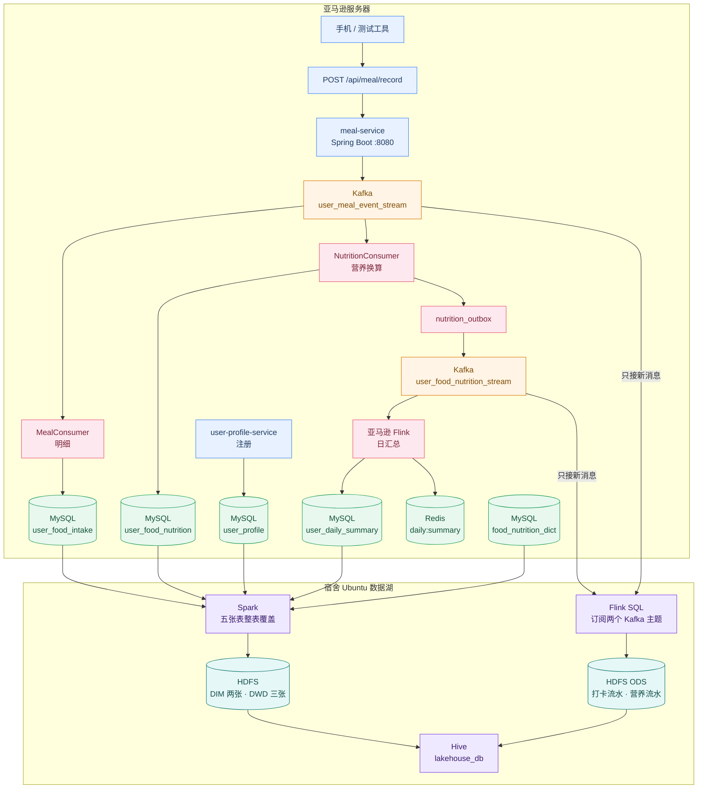

<a id="zh"></a>

<div align="center">

# 饮食健康平台

实时打卡、营养换算，以及宿舍 Ubuntu 上的 Hadoop 数据湖

[能做什么](#zh-what) · [架构](#zh-arch) · [数据湖](#zh-lake) · [目录](#zh-layout) · [模块](#zh-modules) · [数据表](#zh-tables) · [健康指标](#zh-metrics) · [启动](#zh-start) · [English](README.md)

技术栈

        

</div>

这个仓库是整个项目，包含两台机器。

亚马逊服务器负责实时链路：用户通过 HTTP 上报吃了什么和多少克，Spring Boot 写入 Kafka，换算营养后由 Flink 做按人按天的日汇总，结果放在 MySQL 和 Redis。宿舍里的 Ubuntu 负责数据湖：主动连接亚马逊，把同一份已经算好的数据拉进 Hadoop，供以后的 Spark 分析。营养只在亚马逊计算一次。

数据湖的拉取、Hive 和集群写在下面的 [宿舍 Ubuntu 数据湖](#zh-lake)。先写亚马逊服务器。服务器上的代码是多模块工程，不是单一 Maven 父项目。

<a id="zh-what"></a>

## 系统能做什么

1. 接收用户上传的进食内容（食物编码、食物名称、食用克数、餐次）。
2. 把记录投递到 Kafka 主题 `user_meal_event_stream`。
3. **分支 A（明细）**：`meal-service` 的打卡消费者写入 `user_food_intake`。同一主题的换算消费者查食物字典后写入 `user_food_nutrition`。
4. **分支 B（汇总）**：Flink 作业按用户、自然日做 5 秒滚动窗口聚合，结果同时写入：
   - MySQL 表 `user_daily_summary`（累计 UPSERT）
   - Redis Hash `daily:summary:{userId}:{statDate}`（TTL 2 天，便于实时查询）

`data/` 里是 NHANES 2021–2023 的公开调查数据，只供学习、课程讨论和本项目的方法演示，不能当作医疗建议。来源和字段见 [`data/README.md`](data/README.md)。

<a id="zh-arch"></a>

## 整体架构



宿舍这台机器主动连到亚马逊。紫色是数据湖：Flink 把两个 Kafka 主题的新消息写成 ODS 流水，Spark 把 MySQL 里的档案、字典、打卡、营养和日汇总整表覆盖到 HDFS。营养不在 Ubuntu 重算。

<a id="zh-lake"></a>

## 宿舍 Ubuntu 数据湖

这是宿舍内网里的分析侧，主机 `192.168.164.128`，用户 `ccl`。亚马逊连不进宿舍内网，这台机器主动连出去拉取。服务器公网地址不写进仓库，只留在运行这台机器的环境变量里。这边只拉取已经算好的结果。

配置仍在 `ubuntu/` 目录。机器上正在跑的容器使用 `/home/ccl/flink-cluster` 和 `/home/ccl/hdfs-cluster`。仓库里这份配置不包含 NameNode 数据、Hive 元数据和日志。旧的 `kafka_to_hdfs_parquet.sql` 和 Flume 配置没有放进来，不要再提交那份旧作业。

```text
ubuntu/
  flink/jobs/ods_kafka_to_hdfs.sql    订阅两个 Kafka 主题，写入 ODS
  flink/docker-compose.yml            Flink JobManager 和 TaskManager
  flink/docker-compose-hive.yml       HiveServer2
  flink/hive-entrypoint.sh
  flink/hadoop-conf/                  core-site、hdfs-site、hive-site
  hdfs/docker-compose.yml             NameNode
  hive/lakehouse_full.sql             Hive 外部表
  scripts/sync_full_user_data.py      Spark 从 MySQL 整表覆盖
  scripts/train_bmi_weight_regression.py
                                      用单日饮食做 BMI、体重截面回归，还没有产出模型
```

### Flink：新打卡进入 ODS

| Kafka 主题 | 消费组 | HDFS |
|---|---|---|
| `user_meal_event_stream` | `lakehouse_ods_meal_event_v1` | `/lakehouse/ods/meal_event` |
| `user_food_nutrition_stream` | `lakehouse_ods_food_nutrition_v1` | `/lakehouse/ods/food_nutrition_event` |

`scan.startup.mode` 是 `latest-offset`，从提交那一刻的队列末尾往后读。提交前已经留在主题里的旧消息不会进 HDFS。

```bash
docker cp ubuntu/flink/jobs/ods_kafka_to_hdfs.sql flink_jobmanager:/tmp/ods_kafka_to_hdfs.sql
docker exec -e TERM=dumb flink_jobmanager ./bin/sql-client.sh -f /tmp/ods_kafka_to_hdfs.sql
```

仓库里的 SQL 把 Kafka 地址写成 `KAFKA_BOOTSTRAP:9092`。提交前在本机换成真实地址，不要把公网地址提交回来。这台机器上正在使用的文件是 `/home/ccl/flink-cluster/jobs/ods_kafka_to_hdfs.sql`。容器设置了 `restart: always`。开机只会拉起空集群，不会自动再交这份 SQL。作业停了之后，再次提交仍从当时的末尾开始，停机期间的新消息不会补进来。

### Spark：五张全量表

运行前设置 `MYSQL_PASSWORD`。脚本不把 `password_hash` 写入数据湖。`user_food_nutrition.timestamp` 写入湖时列名是 `event_time`。

```bash
export MYSQL_HOST='数据库地址'
export MYSQL_PASSWORD='数据库密码'
HADOOP_CONF_DIR=/usr/local/hadoop/etc/hadoop \
JAVA_HOME=/usr/lib/jvm/java-8-openjdk-amd64 \
/usr/local/spark/bin/spark-submit --master 'local[2]' --driver-memory 1g \
  ubuntu/scripts/sync_full_user_data.py
```

| MySQL | Hive 表 | HDFS |
|---|---|---|
| `user_profile` | `dim_user_profile` | `/lakehouse/dim/user_profile` |
| `food_nutrition_dict` | `dim_food_nutrition_dict` | `/lakehouse/dim/food_nutrition_dict` |
| `user_food_intake` | `dwd_user_food_intake` | `/lakehouse/dwd/user_food_intake` |
| `user_food_nutrition` | `dwd_user_food_nutrition` | `/lakehouse/dwd/user_food_nutrition` |
| `user_daily_summary` | `dwd_user_daily_summary` | `/lakehouse/dwd/user_daily_summary` |

个人档案和日汇总没有 Kafka 主题，只能靠这次整表读取。全量分析读 DIM、DWD 和日汇总。不要把 ODS 和 DWD 加在一起，同一顿饭会算两次。

2026-10-14 跑过一次：食物字典 3989 行，四张用户表 0 行，因为当时亚马逊上的用户数据已经清空。亚马逊重新写入全量之后，需要再执行一次。

### Hive

```bash
beeline -u 'jdbc:hive2://127.0.0.1:10000/lakehouse_db' -n ccl
```

表定义在 `ubuntu/hive/lakehouse_full.sql`。`dwd_user_daily_summary` 的内容是一个人一天的合计，表名仍放在 `dwd_` 下。没有单独的 DWS 或 ADS。

### 集群

| 组件 | 地址或容器 |
|---|---|
| HDFS NameNode | `hdfs://192.168.164.128:9000`，容器 `hdfs_namenode` |
| DataNode | `node2`（192.168.164.129）、`node3`（192.168.164.130），副本数 2 |
| Flink | `flink_jobmanager`、`flink_taskmanager`，页面 `http://127.0.0.1:8081` |
| HiveServer2 | `hive_server`，端口 `10000` |

调查 CSV 和 NHANES 原始 XPT 在 [`data/README.md`](data/README.md)。机器上的副本仍在 `/home/ccl/data`。

<a id="zh-layout"></a>

## 目录结构

```
.
├── meal-service/                 Spring Boot 饮食上报与明细落库服务
│   ├── pom.xml
│   └── src/main/java/com/example/meal_service/
│       ├── MealServiceApplication.java
│       ├── MealController.java   POST /api/meal/record
│       ├── MealEvent.java        事件 DTO
│       ├── MealConsumer.java     Kafka 消费并写入 user_food_intake
│       ├── NutritionConsumer.java 另一消费者组，查字典后写入 user_food_nutrition
│       ├── NutritionConversionService.java 事务换算并建立发件箱事件
│       ├── NutritionOutboxPublisher.java 重试发布营养事件
│       ├── FoodIntakeEntity.java 对应表 user_food_intake
│       ├── FoodIntakeRepository.java
│       ├── FoodNutritionEntity.java 对应表 food_nutrition_dict
│       ├── FoodNutritionRepository.java
│       ├── MealRecordEntity.java 对应表 user_food_nutrition
│       └── MealRecordRepository.java
├── meal-flink-job/               Flink 日汇总实时作业
│   ├── pom.xml
│   └── src/main/java/com/meal/flink/NutritionDailySummaryJob.java
├── user-profile-service/          Spring Boot 用户档案服务
├── data/                          NHANES 公开数据，供学习讨论，见 data/README.md
├── scripts/data-import/           食物字典导入与补全脚本
├── docs/                          专题文档、压测计划和原始设计方案
├── start-flink-job.sh            等待 Flink 就绪后提交作业（防重复提交）
├── ubuntu/                        宿舍 Ubuntu 上的 Hadoop 数据湖
│   ├── flink/                     订阅 Kafka 写入 ODS，以及 Hive 容器
│   ├── hdfs/                      NameNode
│   ├── hive/lakehouse_full.sql    Hive 外部表
│   └── scripts/                   Spark 全量覆盖，以及尚未跑完的回归脚本
└── README.md                      项目总说明
```

<a id="zh-modules"></a>

## 模块说明

### 1. meal-service

- **技术栈**：Spring Boot 4.1.1、Java 17、Spring Web、Spring Kafka、Spring Data JPA、MySQL Connector
- **端口**：`8080`
- **Kafka**：`localhost:9092`
- **MySQL**：`jdbc:mysql://localhost:3306/diet_health`（用户 `root`，密码用环境变量 `MYSQL_PASSWORD`，不写进仓库）
- **JPA**：`spring.jpa.hibernate.ddl-auto=none`，表需事先建好

#### HTTP 接口

`POST /api/meal/record`

请求体示例：

```json
{
  "userId": "user_001",
  "timestamp": 1728691200000,
  "mealType": "Lunch",
  "foodCode": "11100000",
  "foodName": "米饭",
  "portionG": 200.0
}
```

- `userId`、`mealType`、`foodCode`、`foodName` 必填。
- `portionG` 必须大于 0。
- `timestamp` 为空时服务端填入当前毫秒时间戳。
- 服务端用 Jackson 生成 JSON 投递 Kafka，**分区 key 为 `userId`**。

当前写入原始 Kafka 主题的字段是：`userId`、`timestamp`、`mealType`、`foodCode`、`foodName`、`portionG`。营养换算完成后会通过事务发件箱把完整营养事件写到 `user_food_nutrition_stream`，Flink 只消费这个新主题。

#### Kafka 消费落库

`MealConsumer` 监听同一主题，消费者组 `meal_mysql_consumer_group`，并发度 3。字段齐全时写入 `user_food_intake`。毫秒时间戳按 UTC 转成 `record_time`。缺食物字段的旧消息会被跳过并记错误日志。

`NutritionConsumer` 用另一个消费者组 `meal_nutrition_consumer_group` 读同一主题。它按 `food_code` 查 `food_nutrition_dict`，用 `字典值 × portion_g / unit_weight_g` 写入 `user_food_nutrition` 的普通营养和 HEI 食物当量。补不上的食物构成写 `NULL`，并把 `pattern_data_available` 设为 0。营养行和 `nutrition_outbox` 事件在同一个 MySQL 事务中保存；后台发布器把事件可靠地发送到 `user_food_nutrition_stream`，失败时持续重试。

### 2. meal-flink-job

- **技术栈**：Apache Flink 1.17.2、Java 11、Flink Kafka Connector、Flink JDBC Connector、Jedis
- **主类**：`com.meal.flink.NutritionDailySummaryJob`
- **作业名**：`MealDailySummaryRealtimeAggregationJob`
- **主题**：`user_food_nutrition_stream`
- **消费者组**：`flink_nutrition_daily_summary_v1`
- **起始位点**：优先恢复已提交位点；第一次从 `earliest` 开始
- **时间**：消息事件时间，按 `Asia/Shanghai` 划分日期，允许 5 分钟乱序
- **状态**：按 `userId + statDate` 保存完整累计，并按 `nutritionId` 去重
- **容错**：每 10 秒 checkpoint

完整说明见 [`docs/FLINK_DAILY_SUMMARY_README.md`](docs/FLINK_DAILY_SUMMARY_README.md)。

#### MySQL Sink

对 `user_daily_summary` 做 `INSERT ... ON DUPLICATE KEY UPDATE`，每次覆盖当天完整累计值。要求表上有 `(user_id, stat_date)` 唯一键。

#### Redis Sink

写入 Hash：

```
daily:summary:{userId}:{yyyy-MM-dd}
```

字段包括 `total_calories`、`total_carbohydrate_g`、`total_protein_g`、`total_fat_g`、`total_sodium_mg`、`total_potassium_mg`、`meal_count`。过期时间 172800 秒（2 天）。连接地址硬编码为 `localhost:6379`。

Flink 作业目前把 Kafka / MySQL / Redis 都写成 `localhost`。本环境中 JobManager / TaskManager 使用 **host 网络**，因此容器内 `localhost` 可以访问宿主机上的 Kafka、MySQL、Redis。若改成 bridge 网络，需要同步改这些地址。

### 3. data/

`data/diet_foods_extracted.csv` 有 100116 行、6751 名受访者，一行是一种食物。字段包括受访者编号、年龄、性别、种族、BMI、体重、身高、腰围、进食钟点、餐次、USDA 食物编码、食物名、克数，以及这一份的热量、碳水、蛋白质、总脂肪、总糖和钠。编号 130378–142310 对应 NHANES 2021 年 8 月至 2023 年 8 月的公开数据。它不直接进入实时链路，用来导入档案和食物字典，也作为离线分析样本。

`data/nhanes/2021-2023/` 是同一周期从 CDC 下载的原始 XPT，包括体力活动、血压、血脂、血糖、糖化血红蛋白、睡眠、吸烟、饮酒和自报病史。官方链接和学习用途写在 [`data/README.md`](data/README.md)。

<a id="zh-tables"></a>

## 数据表（diet_health）

库里保留 5 张表：用户档案、吃了什么、营养指标、食物营养字典、Flink 日汇总。

### user_profile

用户账号和身体档案。手机注册由 `user-profile-service` 写入，`source_type` 为 `real`。CSV 里的 6751 名受访者由 `scripts/data-import/import_user_profiles.py` 写入，`user_id`、`account` 和 `nhanes_respondent_id` 都使用受访者编号，`source_type` 为 `nhanes`。调查数据没有活动量、目标和目标热量，这些列保持为空。

主键：`user_id`。`account` 唯一。

| 字段 | 类型 | 说明 |
|------|------|------|
| `user_id` | varchar(64) | 主键。手机注册由服务端生成；调查用户等于受访者编号 |
| `account` | varchar(64) | 登录账号，唯一 |
| `password_hash` | varchar(255) | PBKDF2-SHA256 密码哈希 |
| `display_name` | varchar(64) | 昵称 |
| `source_type` | varchar(32) | `real` 为手机注册用户，`nhanes` 为调查受访者 |
| `nhanes_respondent_id` | bigint | 演示受访者编号，真实用户为空 |
| `age` | int | 周岁 |
| `gender` | varchar(16) | `Male` 或 `Female` |
| `height_cm` | decimal(5,2) | 身高，厘米 |
| `weight_kg` | decimal(5,2) | 体重，公斤 |
| `waist_cm` | decimal(5,2) | 腰围，厘米 |
| `bmi` | decimal(4,2) | 体质指数 |
| `activity_level` | varchar(32) | `sedentary`、`light`、`moderate`。调查用户为空 |
| `pal_coefficient` | decimal(4,3) | 活动系数。调查用户为空 |
| `goal_type` | varchar(16) | `lose`、`maintain`、`gain`。调查用户为空 |
| `target_weight_kg` | decimal(5,2) | 目标体重，公斤 |
| `target_calories` | decimal(7,2) | 早期目标热量。当前建档和调查导入都不写此列 |
| `created_at` | timestamp | 创建时间 |
| `updated_at` | timestamp | 更新时间 |

### user_food_intake

用户实际上传的进食内容。一行是一种食物，记录吃了什么和多少克。`meal-service` 消费 Kafka 后写入本表。营养结果在 `user_food_nutrition`，用 `intake_id` 指回本表的 `id`。

主键：`id`。索引：`(user_id, record_time)`、`food_code`。

| 字段 | 类型 | 说明 |
|------|------|------|
| `id` | bigint | 自增主键 |
| `user_id` | varchar(64) | 用户 ID |
| `record_time` | datetime | 进食时间 |
| `meal_type` | varchar(32) | 早餐、午餐、晚餐或加餐 |
| `food_code` | varchar(64) | 食物编码，对应 `food_nutrition_dict.food_code` |
| `food_name` | varchar(128) | 上传时的食物名称 |
| `portion_g` | decimal(10,2) | 食用克数 |
| `created_at` | timestamp | 上传时间 |

### user_food_nutrition

一条打卡算出来的营养结果。一行对应 `user_food_intake` 的一行，用 `intake_id` 指回去。换算消费者写入普通营养、脂肪酸和 HEI 食物当量；食物构成未知时相关列为 `NULL`，不会用 0 冒充。

主键：`id`。索引：`(user_id, timestamp)`、`intake_id`。外键：`intake_id` → `user_food_intake.id`，删除打卡时把 `intake_id` 置空。

| 字段 | 类型 | 说明 |
|------|------|------|
| `id` | bigint | 自增主键 |
| `user_id` | varchar(64) | 用户 ID |
| `intake_id` | bigint | 对应 `user_food_intake.id`。已有旧行先为空 |
| `timestamp` | bigint | 事件时间，毫秒 |
| `meal_type` | varchar(32) | 餐次 |
| `calories` | double | 热量，千卡。默认 0 |
| `carbohydrate_g` | double | 碳水，克。默认 0 |
| `protein_g` | double | 蛋白质，克。默认 0 |
| `total_fat_g` | double | 总脂肪，克。默认 0 |
| `total_sugar_g` | double | 总糖，克。默认 0 |
| `dietary_fiber_g` | double | 膳食纤维，克。默认 0 |
| `sodium` | double | 钠，毫克。默认 0 |
| `potassium` | double | 钾，毫克。默认 0 |
| `added_sugar_g` | double | 添加糖，克。未知时为空 |
| `saturated_fat_g` | double | 饱和脂肪，克。默认 0 |
| `monounsaturated_fat_g` | double | 单不饱和脂肪，克 |
| `polyunsaturated_fat_g` | double | 多不饱和脂肪，克 |
| `whole_grain_oz_eq` | double | 全谷物，盎司当量 |
| `refined_grain_oz_eq` | double | 精制谷物，盎司当量 |
| `total_vegetable_cup_eq` | double | 蔬菜总量，杯当量 |
| `dark_green_veg_beans_cup_eq` | double | 深色蔬菜和豆类，杯当量 |
| `total_fruit_cup_eq` | double | 水果总量，杯当量 |
| `whole_fruit_cup_eq` | double | 完整水果，杯当量 |
| `dairy_cup_eq` | double | 乳制品，杯当量 |
| `seafood_plant_protein_oz_eq` | double | 海产品或植物蛋白，盎司当量 |
| `pattern_data_available` | tinyint(1) | HEI 食物构成是否已知 |
| `unsaturated_saturated_fat_ratio` | double | 不饱和脂肪与饱和脂肪的比值。默认 0 |

### food_nutrition_dict

食物营养表。按食物编码保存每 100 克的营养素，供食物查询和换算。热量、碳水、蛋白质、总脂肪和钠来自 `data/diet_foods_extracted.csv`，由 `scripts/data-import/import_food_nutrition_dict.py` 按「营养合计 ÷ 克数合计 × 100」写入，共 3986 种 USDA 食物。钾、总糖、膳食纤维、饱和脂肪、单不饱和脂肪、多不饱和脂肪、胆固醇、维生素 A、C、D、E、K、硫胺素、核黄素、烟酸、维生素 B6、叶酸、维生素 B12、钙、铁、镁、锌、硒、咖啡因和酒精来自 FNDDS 2021–2023，文件在 `data/FNDDS_2021-2023_Nutrient_Values.xlsx`，由 `scripts/data-import/supplement_food_dict_from_fndds.py` 按食物编码补上。添加糖和 HEI 食物构成由 `scripts/data-import/supplement_food_patterns.py` 写入。优先用 FPED 2017–2020 年 3 月（`data/FPED_1720.xls`）按食物编码直接匹配，这一档已经是每 100 克。对不上的食物，用 FNDDS 2021–2023 食谱（`data/FNDDS_2021-2023_Ingredients.xlsx`）乘以 FPID 2017–2018 原料当量（`data/FPID_1718.xls`），再按成品重量折回每 100 克。FPED 2021–2023 还没有发布，所以这不是那一版的官方文件。3989 条字典里，3957 条直接匹配，16 条由食谱折算，16 条补不上，包括 `F1001`、`F1002`、`F1003`。补不上的成分留空，不用 0 代替。

主键：`id`。唯一键：`food_code`。索引：`food_name`。

| 字段 | 类型 | 说明 |
|------|------|------|
| `id` | bigint | 自增主键 |
| `food_code` | varchar(64) | 食物编码，唯一 |
| `food_name` | varchar(128) | 食物名称 |
| `unit_weight_g` | decimal(6,2) | 营养数值对应的重量，默认 100 克 |
| `energy_kcal` | decimal(6,2) | 该重量下的热量。默认 0 |
| `carbohydrate_g` | decimal(6,2) | 碳水，克 |
| `protein_g` | decimal(6,2) | 蛋白质，克 |
| `total_fat_g` | decimal(6,2) | 脂肪，克 |
| `total_sugar_g` | decimal(6,2) | 总糖，克。来自 FNDDS，每 100 克 |
| `dietary_fiber_g` | decimal(6,2) | 膳食纤维，克。来自 FNDDS，每 100 克 |
| `saturated_fat_g` | decimal(6,2) | 饱和脂肪，克。来自 FNDDS，每 100 克 |
| `monounsaturated_fat_g` | decimal(6,2) | 单不饱和脂肪，克。来自 FNDDS，每 100 克 |
| `polyunsaturated_fat_g` | decimal(6,2) | 多不饱和脂肪，克。来自 FNDDS，每 100 克 |
| `sodium_mg` | decimal(7,2) | 钠，毫克 |
| `potassium_mg` | decimal(7,2) | 钾，毫克。USDA 食物来自 FNDDS |
| `cholesterol_mg` | decimal(7,2) | 胆固醇，毫克。每 100 克 |
| `vitamin_a_rae_mcg` | decimal(7,2) | 维生素 A，微克 RAE。每 100 克 |
| `vitamin_c_mg` | decimal(7,2) | 维生素 C，毫克。每 100 克 |
| `vitamin_d_mcg` | decimal(7,2) | 维生素 D，微克。每 100 克 |
| `vitamin_e_mg` | decimal(7,2) | 维生素 E，毫克。每 100 克 |
| `vitamin_k_mcg` | decimal(7,2) | 维生素 K，微克。每 100 克 |
| `thiamin_mg` | decimal(7,2) | 硫胺素，维生素 B1，毫克。每 100 克 |
| `riboflavin_mg` | decimal(7,2) | 核黄素，维生素 B2，毫克。每 100 克 |
| `niacin_mg` | decimal(7,2) | 烟酸，维生素 B3，毫克。每 100 克 |
| `vitamin_b6_mg` | decimal(7,2) | 维生素 B6，毫克。每 100 克 |
| `folate_mcg` | decimal(7,2) | 叶酸总量，微克。每 100 克 |
| `vitamin_b12_mcg` | decimal(7,2) | 维生素 B12，微克。每 100 克 |
| `calcium_mg` | decimal(7,2) | 钙，毫克。每 100 克 |
| `iron_mg` | decimal(7,2) | 铁，毫克。每 100 克 |
| `magnesium_mg` | decimal(7,2) | 镁，毫克。每 100 克 |
| `zinc_mg` | decimal(7,2) | 锌，毫克。每 100 克 |
| `selenium_mcg` | decimal(7,2) | 硒，微克。每 100 克 |
| `caffeine_mg` | decimal(7,2) | 咖啡因，毫克。每 100 克 |
| `alcohol_g` | decimal(7,2) | 酒精，克。每 100 克 |
| `added_sugar_g` | decimal(8,2) | 添加糖，克。每 100 克。由茶匙当量 × 4.2 得到。空值表示未知 |
| `whole_grain_oz_eq` | decimal(10,4) | 全谷物，盎司当量。每 100 克 |
| `refined_grain_oz_eq` | decimal(10,4) | 精制谷物，盎司当量。每 100 克 |
| `total_vegetable_cup_eq` | decimal(10,4) | 蔬菜总量，杯当量。每 100 克。含豆类 |
| `dark_green_veg_beans_cup_eq` | decimal(10,4) | 深色蔬菜和豆类，杯当量。每 100 克 |
| `total_fruit_cup_eq` | decimal(10,4) | 水果总量，杯当量。每 100 克 |
| `whole_fruit_cup_eq` | decimal(10,4) | 完整水果，杯当量。每 100 克。水果总量减去果汁 |
| `dairy_cup_eq` | decimal(10,4) | 乳制品，杯当量。每 100 克 |
| `seafood_plant_protein_oz_eq` | decimal(10,4) | 海产品和植物蛋白，盎司当量。每 100 克。含鱼、大豆、坚果和豆类 |
| `fped_source` | varchar(32) | 来源。`fped_1720` 是直接匹配，`ingredient_rollup` 是食谱折算，`missing` 是补不上 |

### user_daily_summary

Flink 按用户、按天累计后的分析结果，使用 `INSERT ... ON DUPLICATE KEY UPDATE` 把窗口增量加进去。

主键：`id`。唯一键：`(user_id, stat_date)`。另有 `stat_date` 索引。

| 字段 | 类型 | 说明 |
|------|------|------|
| `id` | bigint | 自增主键 |
| `user_id` | varchar(64) | 用户 ID |
| `stat_date` | date | 汇总日期 |
| `total_calories` | decimal(12,2) | 累计热量，千卡 |
| `total_carbohydrate_g` | decimal(12,2) | 累计碳水，克 |
| `total_protein_g` | decimal(12,2) | 累计蛋白质，克 |
| `total_fat_g` | decimal(12,2) | 累计脂肪，克 |
| `total_sugar_g` | decimal(12,2) | 累计总糖，克 |
| `total_dietary_fiber_g` | decimal(12,2) | 累计膳食纤维，克 |
| `total_added_sugar_g` | decimal(12,2) | 累计添加糖，克 |
| `total_saturated_fat_g` | decimal(12,2) | 累计饱和脂肪，克 |
| `total_monounsaturated_fat_g` | decimal(12,2) | 累计单不饱和脂肪，克 |
| `total_polyunsaturated_fat_g` | decimal(12,2) | 累计多不饱和脂肪，克 |
| `total_sodium_mg` | decimal(14,2) | 累计钠，毫克 |
| `total_potassium_mg` | decimal(14,2) | 累计钾，毫克 |
| `total_*_oz_eq` / `total_*_cup_eq` | decimal(14,4) | HEI 食物构成的累计当量 |
| `meal_count` | int | 累计上报条数 |
| `unknown_pattern_count` | int | 当天食物构成未知的打卡数 |
| `is_calorie_surplus` | tinyint(1) | 是否热量盈余。默认 0。当前 Flink SQL 不更新此列 |
| `updated_at` | timestamp | 最近一次更新时间 |

<a id="zh-metrics"></a>

## 健康指标怎么展示

手机上看到的健康数字分三层。打卡流水保存吃进去的营养素；Flink 保存每天累计值；供能比、能量差额、HEI 分数和预测是下一步计算的展示结果。

### 打卡时保存的营养素

营养指标保存在 `user_food_nutrition`。一行包含热量、碳水、蛋白质、总脂肪、总糖、膳食纤维、钠、钾，以及 HEI-2020 用的添加糖、饱和脂肪、全谷物、精制谷物、蔬菜、深色蔬菜和豆类、水果、完整水果、乳制品、海产品或植物蛋白、不饱和脂肪与饱和脂肪的比值。

当前换算会填写热量、宏量营养素、糖、纤维、脂肪酸、钠、钾、添加糖和全部已有的 HEI 食物当量。未知食物构成保持 `NULL`。

### 直接算出来就能展示的结果

这些不要再存进每一条打卡。把当天打卡加总，再读 `user_profile` 里的年龄、性别、身高、体重和活动系数即可。

| 展示结果 | 算法 | 合适的存放位置 |
|----------|------|----------------|
| 碳水供能比 | 碳水克数 × 4 ÷ 当日总热量。平衡区间 50%–65% | 当日汇总 |
| 蛋白质供能比 | 蛋白质克数 × 4 ÷ 当日总热量。平衡区间 10%–20% | 当日汇总 |
| 脂肪供能比 | 脂肪克数 × 9 ÷ 当日总热量。平衡区间 20%–30% | 当日汇总 |
| 钠钾摩尔比 | `(钠毫克 / 23) ÷ (钾毫克 / 39.1)`。健康阈值 ≤ 1 | 当日汇总 |
| 基础代谢 BMR | 男：`10×体重 + 6.25×身高 − 5×年龄 + 5`。女：最后一项为 −161 | 打开档案时现算，不入库 |
| 每日消耗 TDEE | `BMR × 活动系数`。久坐 1.2，轻度 1.375，中度 1.55 | 打开档案时现算，不入库 |
| 能量差额 | 当日总热量 − TDEE。正数是盈余，负数是缺口 | 当日汇总 |
| 未来 30 天、60 天 BMI | 用近 7 天或 14 天的平均热量，相对 TDEE 的差额按约 7700 千卡折合 1 公斤，并随体重变化修正消耗 | 分析报告，一个人一天一份 |
| 风险等级 | 模型输出 0 低危、1 中危、2 高危。输入是当日营养合计和档案体征 | 分析报告 |
| 前三项原因 | 模型给出贡献最高的三个因素和占比 | 分析报告 |
| 同龄人位置 | 把个人营养合计放到同性别、同年龄段人群里看百分位 | 分析报告。人群分布要单独有一份基准，不能从单次打卡里算出 |

`user_daily_summary` 已累计普通营养、脂肪酸、添加糖、HEI 食物当量和餐次。供能比、钠钾比、HEI 分数和能量差额还没有计算。

### 现在还展示不了的结果

HEI-2020 需要的食物成分已经放在 `food_nutrition_dict`、打卡营养行和日汇总中。分数本身还没有计算。

DII 还要看胆固醇、反式脂肪和多种维生素、矿物质。这些没有放进打卡表，所以炎症指数仍然留空。

## 运行时依赖

当前机器上已用 Docker 跑过：

| 组件 | 镜像 / 部署 | 端口 / 访问 |
|------|-------------|-------------|
| Kafka | `apache/kafka:latest`，容器名 `kafka` | `9092` |
| Redis | `redis:alpine`，容器名 `redis` | `6379` |
| Flink JobManager | `flink:1.17-scala_2.12`，`--network host` | Web UI `8081` |
| Flink TaskManager | 同上 | 与 JobManager 通信 |
| MySQL | 宿主机 `mysql-server` | `3306`，库 `diet_health` |

Kafka 主题：`user_meal_event_stream`。

<a id="zh-start"></a>

## 如何启动

### 1. 基础设施

确保 Kafka、Redis、MySQL、Flink 已启动，并已创建主题与数据库表。

### 2. 启动 meal-service

```bash
cd /home/ubuntu/meal-service
./mvnw spring-boot:run
```

或使用已打包的 jar：

```bash
java -jar /home/ubuntu/meal-service/target/meal-service-0.0.1-SNAPSHOT.jar
```

### 3. 打包并提交 Flink 作业

```bash
cd /home/ubuntu/meal-flink-job
mvn -DskipTests package
/home/ubuntu/start-flink-job.sh
```

`start-flink-job.sh` 会：

1. 轮询 `http://localhost:8081/overview`，等待 Flink 就绪。
2. 若作业 `MealDailySummaryRealtimeAggregationJob` 已在运行则跳过。
3. 把 `meal-flink-job-1.0.0.jar` 拷进 JobManager 并 `flink run -d` 后台提交。

Flink Web UI：<http://localhost:8081>

### 4. 上报一条饮食记录

```bash
curl -X POST http://127.0.0.1:8080/api/meal/record \
  -H "Content-Type: application/json" \
  -d '{
    "userId": "user_001",
    "mealType": "Breakfast",
    "foodCode": "11100000",
    "foodName": "米饭",
    "portionG": 150
  }'
```

成功后：

- Kafka 主题出现一条 JSON。
- MySQL `user_food_intake` 增加一行。
- 若 `food_code` 在 `food_nutrition_dict` 中，`user_food_nutrition` 增加一行，并通过 `intake_id` 指回这条打卡。
- 营养事务发件箱发布成功后，Flink 消费营养主题并覆盖更新 MySQL 与 Redis 日汇总。

## 已知限制（当前实现）

- 添加糖和 HEI 食物构成直接匹配用的是 FPED 2017–2020 年 3 月，不是尚未发布的 FPED 2021–2023。食物构成未知时会增加 `unknown_pattern_count`，当天 HEI 不能视为完整结果。
- 字典里没有的食物编码不会生成营养行。没有对应打卡的旧营养行不会回填。
- 启动前要设置环境变量 `MYSQL_PASSWORD`。数据库地址仍写在配置文件中。
- Flink checkpoint 目前在容器文件系统；删除并重建容器前需要改成持久卷、HDFS 或 S3。
- HEI 最终分数、供能比、钠钾比、TDEE 和模型分析尚未实现。
- 工作区没有 Docker Compose、建表 SQL 和数据导入脚本的完整交付件。

## 技术栈一览

| 层 | 技术 |
|----|------|
| 接入服务 | Spring Boot 4.1.1、Java 17、Spring MVC、Spring Kafka、JPA |
| 消息队列 | Apache Kafka |
| 流计算 | Apache Flink 1.17.2 |
| 存储 | MySQL（明细 + 日汇总）、Redis（热汇总） |
| 离线数据 | `data/diet_foods_extracted.csv`（NHANES 风格饮食记录） |
| 数据湖 | 宿舍 Ubuntu 上的 HDFS、Hive、Spark，见 `ubuntu/` |
