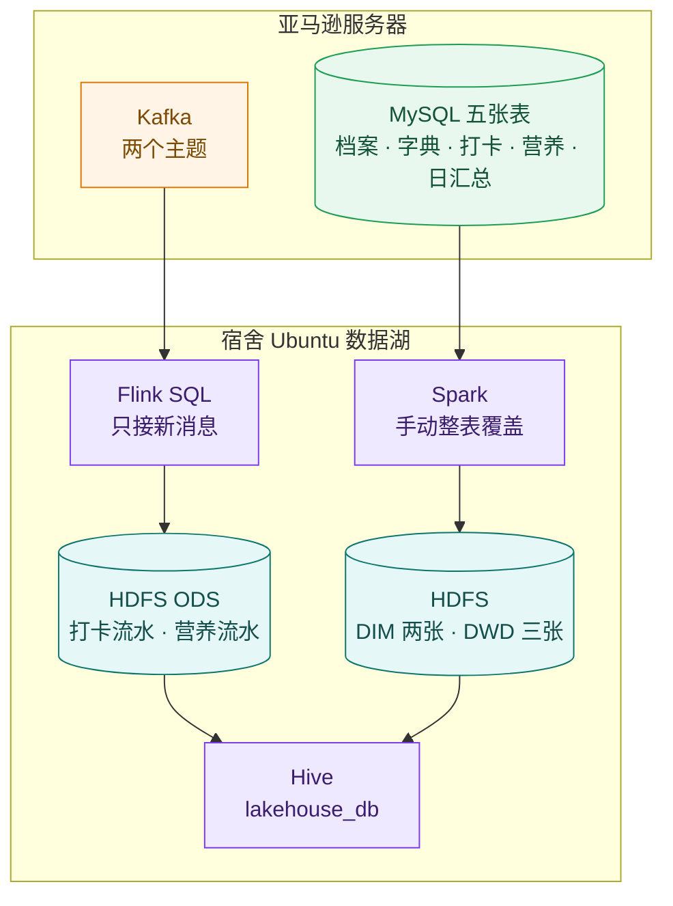
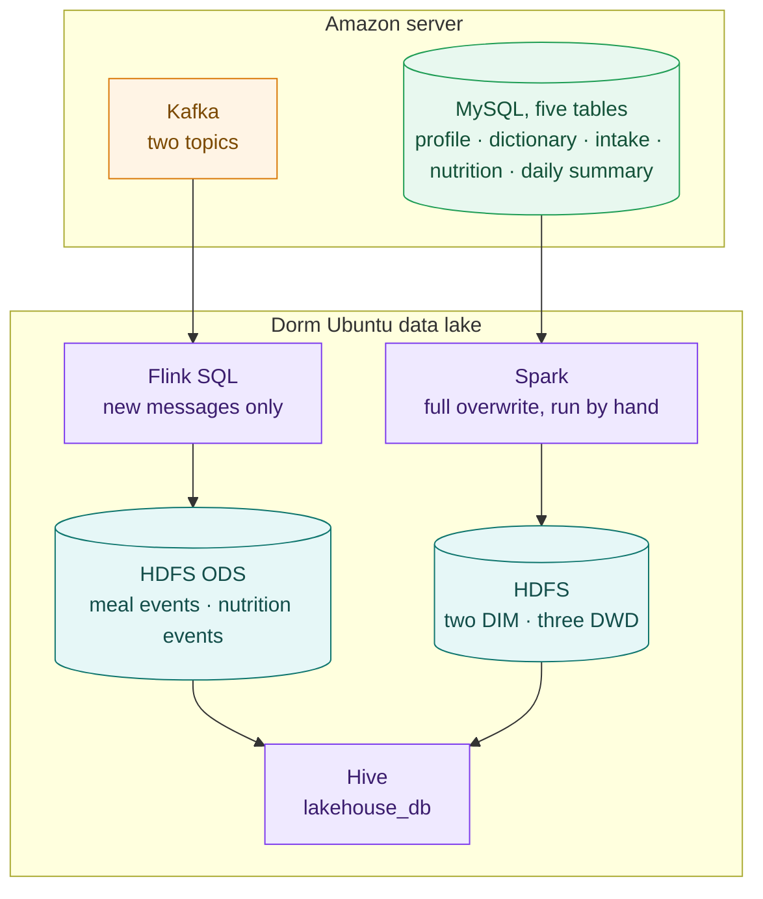

[中文](#ubuntu-数据湖) | [English](#ubuntu-data-lake)

# Ubuntu 数据湖

这是宿舍内网里的分析侧，主机 `192.168.164.128`，用户 `ccl`。亚马逊服务器上的打卡、营养换算、MySQL 和 Kafka 在仓库根目录。这边只拉取已经算好的结果，不在这里重算营养。

宿舍网络是内网，亚马逊连不进来。这台机器主动连接公网 `REDACTED_HOST`。



## 目录

```text
ubuntu/
  flink/jobs/ods_kafka_to_hdfs.sql    订阅两个 Kafka 主题，写入 ODS
  flink/docker-compose.yml            Flink JobManager 和 TaskManager
  flink/docker-compose-hive.yml       HiveServer2
  flink/hive-entrypoint.sh
  flink/hadoop-conf/                  core-site、hdfs-site、hive-site
  hdfs/docker-compose.yml             NameNode
  hive/lakehouse_full.sql             Hive 外部表
  scripts/sync_full_user_data.py      Spark 从 MySQL 整表覆盖
  scripts/train_bmi_weight_regression.py
                                      用单日饮食做 BMI、体重截面回归，还没有产出模型
```

机器上正在跑的容器仍使用 `/home/ccl/flink-cluster` 和 `/home/ccl/hdfs-cluster`。这里是交给仓库的同一份配置，不包含 NameNode 数据、Hive 元数据和日志。

旧的 `kafka_to_hdfs_parquet.sql` 和 Flume 配置没有放进来，不要再提交那份旧作业。

## Flink：新打卡进入 ODS

| Kafka 主题 | 消费组 | HDFS |
|---|---|---|
| `user_meal_event_stream` | `lakehouse_ods_meal_event_v1` | `/lakehouse/ods/meal_event` |
| `user_food_nutrition_stream` | `lakehouse_ods_food_nutrition_v1` | `/lakehouse/ods/food_nutrition_event` |

`scan.startup.mode` 是 `latest-offset`，从提交那一刻的队列末尾往后读。提交前已经留在主题里的旧消息不会进 HDFS。

```bash
docker cp ubuntu/flink/jobs/ods_kafka_to_hdfs.sql flink_jobmanager:/tmp/ods_kafka_to_hdfs.sql
docker exec -e TERM=dumb flink_jobmanager ./bin/sql-client.sh -f /tmp/ods_kafka_to_hdfs.sql
```

在这台机器上，源文件的实际路径是 `/home/ccl/flink-cluster/jobs/ods_kafka_to_hdfs.sql`。

容器设置了 `restart: always`。开机只会拉起空集群，不会自动再交这份 SQL。作业停了之后，再次提交仍从当时的末尾开始，停机期间的新消息不会补进来。

## Spark：五张全量表

运行前设置 `MYSQL_PASSWORD`。脚本不把 `password_hash` 写入数据湖。`user_food_nutrition.timestamp` 写入湖时列名是 `event_time`。

```bash
export MYSQL_PASSWORD='数据库密码'
HADOOP_CONF_DIR=/usr/local/hadoop/etc/hadoop \
JAVA_HOME=/usr/lib/jvm/java-8-openjdk-amd64 \
/usr/local/spark/bin/spark-submit --master 'local[2]' --driver-memory 1g \
  ubuntu/scripts/sync_full_user_data.py
```

| MySQL | Hive 表 | HDFS |
|---|---|---|
| `user_profile` | `dim_user_profile` | `/lakehouse/dim/user_profile` |
| `food_nutrition_dict` | `dim_food_nutrition_dict` | `/lakehouse/dim/food_nutrition_dict` |
| `user_food_intake` | `dwd_user_food_intake` | `/lakehouse/dwd/user_food_intake` |
| `user_food_nutrition` | `dwd_user_food_nutrition` | `/lakehouse/dwd/user_food_nutrition` |
| `user_daily_summary` | `dwd_user_daily_summary` | `/lakehouse/dwd/user_daily_summary` |

个人档案和日汇总没有 Kafka 主题，只能靠这次整表读取。全量分析读 DIM、DWD 和日汇总。不要把 ODS 和 DWD 加在一起，同一顿饭会算两次。

2026-10-14 跑过一次：食物字典 3989 行，四张用户表 0 行，因为当时亚马逊上的用户数据已经清空。亚马逊重新写入全量之后，需要再执行一次。

## Hive

```bash
beeline -u 'jdbc:hive2://127.0.0.1:10000/lakehouse_db' -n ccl
```

表定义在 `hive/lakehouse_full.sql`。`dwd_user_daily_summary` 的内容是一个人一天的合计，表名仍放在 `dwd_` 下。没有单独的 DWS 或 ADS。

## 集群

| 组件 | 地址或容器 |
|---|---|
| HDFS NameNode | `hdfs://192.168.164.128:9000`，容器 `hdfs_namenode` |
| DataNode | `node2`（192.168.164.129）、`node3`（192.168.164.130），副本数 2 |
| Flink | `flink_jobmanager`、`flink_taskmanager`，页面 `http://127.0.0.1:8081` |
| HiveServer2 | `hive_server`，端口 `10000` |

调查 CSV 和 NHANES 原始 XPT 在仓库的 [`data/`](../data/README.md)。机器上的副本仍在 `/home/ccl/data`。

---

[中文](#ubuntu-数据湖) | [English](#ubuntu-data-lake)

# Ubuntu data lake

This is the analysis side on the dorm LAN. The host is `192.168.164.128` and the user is `ccl`. Check-in, nutrient conversion, MySQL, and Kafka on the Amazon server are at the repository root. This side only pulls results that have already been calculated. It does not calculate nutrition again.

The dorm network is private. Amazon cannot connect in. This machine connects out to `REDACTED_HOST`.



## Layout

```text
ubuntu/
  flink/jobs/ods_kafka_to_hdfs.sql    subscribe to both Kafka topics and write ODS
  flink/docker-compose.yml            Flink JobManager and TaskManager
  flink/docker-compose-hive.yml       HiveServer2
  flink/hive-entrypoint.sh
  flink/hadoop-conf/                  core-site, hdfs-site, hive-site
  hdfs/docker-compose.yml             NameNode
  hive/lakehouse_full.sql             Hive external tables
  scripts/sync_full_user_data.py      Spark full overwrite from MySQL
  scripts/train_bmi_weight_regression.py
                                      cross-sectional BMI and weight regression from one dietary day; no model has been produced
```

The containers that are running still use `/home/ccl/flink-cluster` and `/home/ccl/hdfs-cluster`. This directory is the same configuration committed to the repository. It does not include NameNode data, the Hive metastore, or logs.

The old `kafka_to_hdfs_parquet.sql` and the Flume configuration are not included. Do not submit that old job again.

## Flink: new check-ins land in ODS

| Kafka topic | Consumer group | HDFS |
|---|---|---|
| `user_meal_event_stream` | `lakehouse_ods_meal_event_v1` | `/lakehouse/ods/meal_event` |
| `user_food_nutrition_stream` | `lakehouse_ods_food_nutrition_v1` | `/lakehouse/ods/food_nutrition_event` |

`scan.startup.mode` is `latest-offset`. Reading starts at the end of the topic at submission time. Messages already in the topic are not written to HDFS.

```bash
docker cp ubuntu/flink/jobs/ods_kafka_to_hdfs.sql flink_jobmanager:/tmp/ods_kafka_to_hdfs.sql
docker exec -e TERM=dumb flink_jobmanager ./bin/sql-client.sh -f /tmp/ods_kafka_to_hdfs.sql
```

On this machine the live file is `/home/ccl/flink-cluster/jobs/ods_kafka_to_hdfs.sql`.

The containers use `restart: always`. A reboot starts an empty cluster and does not submit this SQL again. After the job stops, the next submission again starts at the end of the topic, so messages produced during the downtime are not backfilled.

## Spark: five full tables

Set `MYSQL_PASSWORD` before running. The script does not write `password_hash` into the lake. `user_food_nutrition.timestamp` is stored as `event_time`.

```bash
export MYSQL_PASSWORD='database password'
HADOOP_CONF_DIR=/usr/local/hadoop/etc/hadoop \
JAVA_HOME=/usr/lib/jvm/java-8-openjdk-amd64 \
/usr/local/spark/bin/spark-submit --master 'local[2]' --driver-memory 1g \
  ubuntu/scripts/sync_full_user_data.py
```

| MySQL | Hive table | HDFS |
|---|---|---|
| `user_profile` | `dim_user_profile` | `/lakehouse/dim/user_profile` |
| `food_nutrition_dict` | `dim_food_nutrition_dict` | `/lakehouse/dim/food_nutrition_dict` |
| `user_food_intake` | `dwd_user_food_intake` | `/lakehouse/dwd/user_food_intake` |
| `user_food_nutrition` | `dwd_user_food_nutrition` | `/lakehouse/dwd/user_food_nutrition` |
| `user_daily_summary` | `dwd_user_daily_summary` | `/lakehouse/dwd/user_daily_summary` |

Profiles and daily summaries have no Kafka topic, so they arrive only through this full-table read. Full analysis should read DIM, DWD, and the daily summary. Do not add ODS and DWD together, or the same meal is counted twice.

One run on 2026-10-14 wrote 3,989 food-dictionary rows and 0 rows in the four user tables, because the user data on Amazon had been cleared. Run the command again after Amazon has the full user data.

## Hive

```bash
beeline -u 'jdbc:hive2://127.0.0.1:10000/lakehouse_db' -n ccl
```

Table definitions are in `hive/lakehouse_full.sql`. The contents of `dwd_user_daily_summary` are one person's totals for one day, and the table name stays under `dwd_`. There is no separate DWS or ADS layer.

## Cluster

| Component | Address or container |
|---|---|
| HDFS NameNode | `hdfs://192.168.164.128:9000`, container `hdfs_namenode` |
| DataNode | `node2` (192.168.164.129), `node3` (192.168.164.130), replication 2 |
| Flink | `flink_jobmanager`, `flink_taskmanager`, UI `http://127.0.0.1:8081` |
| HiveServer2 | `hive_server`, port `10000` |

The survey CSV and the original NHANES XPT files are in [`data/`](../data/README.md). The copies on this machine remain in `/home/ccl/data`.

